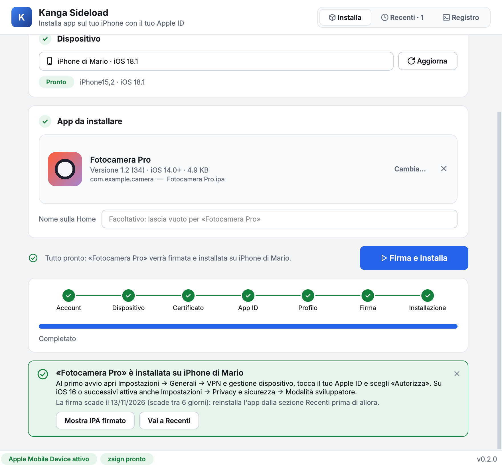
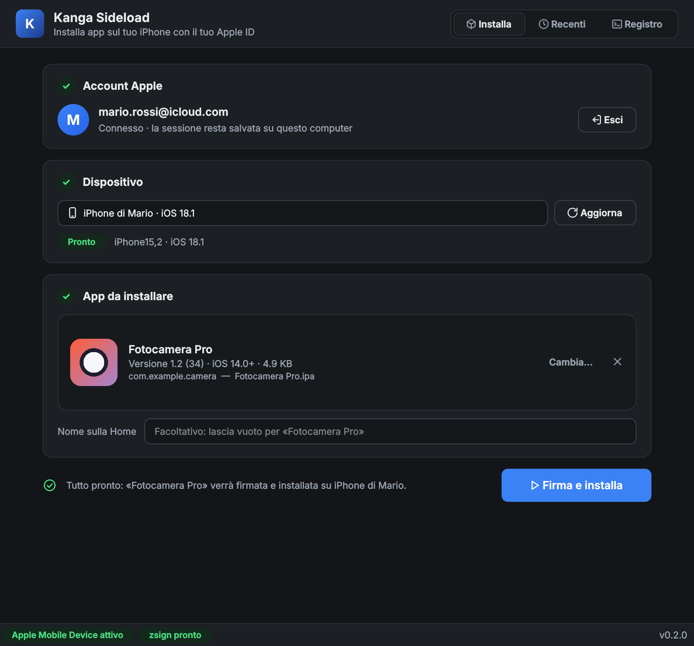
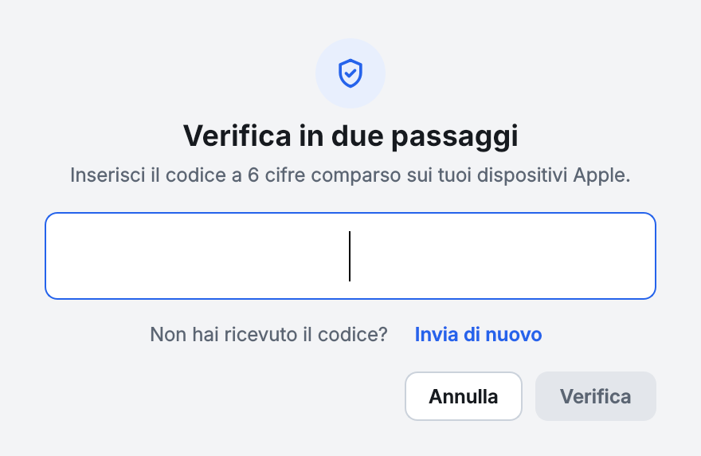

# Kanga Sideload

Sideloader iOS **open source** per Windows, scritto da zero con componenti
open source. Tutte le funzionalità attive da subito, nessun paywall.



Include una sezione **Jailbreak**: per il dispositivo collegato (iPhone, iPad,
iPod touch, anche 32-bit A5/A6) mostra i tool compatibili per modello × iOS e
li installa scaricandoli **solo dalle fonti ufficiali** dei rispettivi progetti
(release GitHub o sito ufficiale):

| Tool | iOS (arm64 A8-A11) | iOS (arm64e A12+) | Tipo |
|---|---|---|---|
| Dopamine | 15.0 – 16.6.1 | 15.0 – 15.4.1 | Jailbreak (sideload) |
| TrollInstallerX | 14.0 – 16.6.1 | 15.0 – 16.5.1 | Installer TrollStore |
| unc0ver | 11.0 – 14.8 | 11.0 – 14.8 | Jailbreak (sideload) |
| Taurine | 14.0 – 14.3 | 14.0 – 14.3 | Jailbreak (sideload) |
| Nugget | 17.0 – 18.x | 17.0 – 18.x | Personalizzazione (non JB) |
| palera1n | 15.0 – 17.x | ✗ (solo A8-A11) | **DFU da PC** (guida, non sideload) |
| Phoenix · EtasonJB · h3lix | iOS 9.3.x · 8.4.1 · 10.x | solo 32-bit (A5/A6) | Jailbreak (sideload) |

I jailbreak checkm8 (palera1n) non sono installabili via sideload: richiedono
la procedura DFU dal PC — la sezione mostra la compatibilità e la guida.

## Com'è fatto

| Componente | Tecnologia | Licenza |
|---|---|---|
| GUI desktop | PySide6 (Qt 6) | LGPL |
| Comunicazione iPhone | pymobiledevice3 (usbmux, lockdown, installation proxy) | GPL-3.0 |
| Anisette | DLL Apple di iTunes/iCloud (AOSKit) se installate, altrimenti pacchetto `anisette` (emulata con Unicorn) | Apple / MIT |
| Login Apple ID | `kanga/core/gsa.py` (GrandSlam SRP-6a variante Apple + 2FA) | nostro |
| Certificato/profilo | `kanga/core/apple_services.py` (developerservices2 QH65B2) | nostro |
| Firma IPA | zsign (binari ufficiali per Windows) | MIT |
| SRP-6a | vendorizzato da cocagne/pysrp in `kanga/core/_vendor/` | MIT |

Licenza del progetto: **GPL-3.0-or-later** (compatibile con pymobiledevice3).

## Requisiti

- Windows 10/11
- Python 3.12 (gestito via [uv](https://docs.astral.sh/uv/))
- **iTunes classico oppure app "Apple Devices"** dal Microsoft Store (forniscono
  il servizio `Apple Mobile Device` per comunicare con l'iPhone via USB)
- Un Apple ID (gratuito va bene) con 2FA attiva — come per Sideloadly/AltStore

## Installazione

```bash
cd KangaSideload
uv venv --python 3.12 .venv
uv pip install --python .venv/Scripts/python.exe -e ".[dev]"
```

Il binario di firma **zsign** si scarica dall'app stessa (pulsante «Scarica
zsign» nella barra in basso) oppure una tantum da riga di comando:

```bash
.venv/Scripts/python.exe scripts/fetch_zsign.py
```

## Uso

Doppio clic su **`Avvia Kanga.bat`** nella cartella del progetto: l'app si apre
senza finestra del terminale (il registro tecnico finisce in
`%LOCALAPPDATA%/Kanga/kanga.log`). Per un collegamento sul Desktop con l'icona
di Kanga (da rifare se sposti la cartella):

```bash
.venv/Scripts/python.exe scripts/crea_collegamento.py
```

Da terminale:

```bash
.venv/Scripts/python.exe -m kanga
```

La finestra **Installa** guida in tre passi e dice sempre cosa manca per
procedere:

1. **Account Apple** — «Accedi» apre il login; il codice di verifica (2FA) si
   inserisce nello stesso dialog, con invio automatico alla sesta cifra e
   «Invia di nuovo» se il codice non arriva. Un codice sbagliato non annulla il
   login: basta inserirne un altro. Con «Ricorda la password» l'accesso
   successivo è automatico (vedi Privacy)
2. **Dispositivo** — l'iPhone viene rilevato da solo appena lo colleghi via USB
   (nessun bisogno di premere Aggiorna). Se il computer non è ancora autorizzato
   compare «Abbina»: sblocca il telefono e tocca «Autorizza»
3. **App** — trascina un `.ipa` nella finestra o sceglilo dal computer: vedi
   icona, nome, versione, iOS minimo e bundle id. Facoltativo: un nome diverso
   per la schermata Home

Poi **Firma e installa**: l'avanzamento mostra ogni passo (account,
dispositivo, certificato, App ID, profilo, firma, installazione). Alla fine
Kanga spiega cosa fare sul telefono (autorizzare lo sviluppatore e, da iOS 16,
attivare la Modalità sviluppatore); in caso di errore mostra cosa è successo e
come risolverlo, con «Riprova» e i dettagli tecnici nel **Registro**.

La sezione **Recenti** elenca le app installate con la data di scadenza della
firma (7 giorni con un account gratuito) e permette di **reinstallarle con un
clic** per rinnovarla; all'avvio Kanga avvisa se una firma sta per scadere.

La sezione **Jailbreak** usa il dispositivo selezionato in Installa: «Scarica
e installa» prende l'IPA dalla fonte ufficiale (cache in
`%LOCALAPPDATA%/Kanga/downloads/`) e lo passa a «Firma e installa». Per i tool
il cui sito originale è offline c'è «Installa IPA…» con un file scelto da te.

La sezione **Firmware** funziona con **qualsiasi iPhone, iPad o iPod touch**:
il modello del dispositivo collegato oppure uno qualsiasi scelto da un elenco con
ricerca (181 modelli, da api.ipsw.me), anche senza nulla di collegato. Mostra
**tutte le versioni di iOS** pubblicate da Apple per quel modello e quali sono
**ancora firmate**. Tutte si possono scaricare; si possono *installare* solo
quelle firmate, come con iTunes/3uTools/Finder, perché ogni ripristino deve
essere autorizzato in tempo reale dai server Apple (TSS). Di solito Apple firma
l'ultima versione e, per qualche giorno dopo un aggiornamento, anche la
precedente: è la finestra per un **downgrade**, che la sezione segnala.

- **Scarica IPSW** (qualsiasi versione, anche non firmata) dai server Apple, con
  ripresa del download e verifica SHA-256 (cache in `%LOCALAPPDATA%/Kanga/ipsw/`)
- **Salva SHSH** (versioni firmate, dispositivo via cavo USB): i ticket di firma
  di Apple in `%LOCALAPPDATA%/Kanga/shsh/<ECID>/`; le versioni con SHSH salvati
  sono segnalate. Servono a futurerestore per installare in futuro una versione
  non più firmata (con i suoi limiti di compatibilità SEP/baseband)
- **Ripristina**: con **iTunes** (consigliato su Windows: Kanga apre iTunes e
  mostra il file, poi Maiusc + «Ripristina iPhone…») oppure **direttamente da
  Kanga** con pymobiledevice3, che su Windows richiede `libusb-1.0.dll` in
  `%LOCALAPPDATA%/Kanga/libusb/` e il driver WinUSB per la modalità Recovery
  (es. con Zadig). Il ripristino cancella tutti i dati

**Downgrade a versioni non firmate (futurerestore).** Per una versione che Apple
non firma più, con l'IPSW scaricato e il dispositivo di quel modello collegato
via USB, compare «Ripristina con SHSH…». Kanga usa
[futurerestore](https://github.com/m1stadev/futurerestore/releases), che scegli
tu (Kanga non scarica eseguibili da server di terzi), e prima di avviarlo
controlla:

- che gli SHSH (quelli salvati da Kanga o un file `.shsh2` scelto da te) siano di
  **questo** dispositivo (ECID): altrimenti il ripristino è bloccato
- che il loro **nonce** coincida con quello attuale del dispositivo: se no avvisa
  che serve impostarlo al generator degli SHSH (jailbreak, oppure pwned DFU sui
  chip A7-A11 con l'opzione `--use-pwndfu --set-nonce`)
- modem presente o no (`--latest-baseband` / `--no-baseband`); SEP più recente
  (`--latest-sep`): se non è compatibile con la versione scelta, futurerestore
  fallisce
- una conferma esplicita del backup, perché tutti i dati vengono cancellati

L'output di futurerestore finisce nel Registro; se fallisce, «Esci da Recovery»
riavvia il dispositivo con il sistema di prima. Nota: futurerestore e iTunes
usano i driver Apple; se per il ripristino diretto di Kanga hai installato il
driver WinUSB (Zadig) per la modalità Recovery, loro non vedranno più il
dispositivo in Recovery finché non rimetti il driver Apple.

Scorciatoie: `Ctrl+O` scegli IPA · `F5` cerca dispositivi · `Ctrl+Invio`
firma e installa · `Ctrl+1…5` cambia sezione.

Il tema chiaro/scuro segue quello di Windows (forzabile con
`KANGA_THEME=light|dark`).

<p>
  
  
</p>

Al primo avvio dall'app installata: *Impostazioni → Generali → VPN e gestione
dispositivo → autorizza il profilo sviluppatore*.

## Limiti Apple (insuperabili, valgono per qualunque sideloader)

- Account gratuito: firma valida **7 giorni**, max **3 app per dispositivo**,
  10 App ID/settimana
- Un account Developer a pagamento ($99/anno) rimuove i limiti (percorso da
  aggiungere in `apple_services.py`)

## Stato noto (novembre 2026): blocco Apple sul login GSA

Da ottobre 2025 Apple sta respingendo i login GrandSlam che usano anisette
"non-Mac" (macchine virtuali ADI emulata) con errori -80045/-80046 e, nelle
onde più recenti, 503 all'endpoint di login. **Anche Sideloadly è stato
colpito** (giorni: fine ottobre 2026); gli strumenti che funzionano usano
l'anisette via librerie iTunes/kbsync ("macchina reale").

Per questo Kanga usa **per prima l'anisette di iTunes**: le DLL Apple
originali (`AOSKit.dll`, `objc.dll`, `Foundation.dll`) di iTunes / iCloud per
Windows, la stessa strada di Sideloadly e AltServer.

**Cosa installare:** [iTunes](https://www.apple.com/itunes/download/win64) e
iCloud per Windows scaricati **dal sito Apple, non dal Microsoft Store** (le
versioni dello Store non espongono le DLL; il link all'installer di iCloud è
nella [guida di AltStore](https://faq.altstore.io/altstore-classic/how-to-install-altstore-windows)).
Se hai già le versioni dello Store disinstallale prima.

Cartelle cercate, in ordine: `Common Files\Apple\Internet Services` (AOSKit,
da iCloud) + `Common Files\Apple\Apple Application Support` (objc/Foundation,
da iTunes), poi set in un'unica cartella (es. 3uTools). Per indicarne una:
`KANGA_APPLE_DLL_DIR="<dir AOSKit>;<dir objc>"`. Le DLL vengono caricate da
`kanga/tools/itunes_anisette_helper.py` in un processo separato (con un Python
della stessa architettura: per DLL a 32 bit serve `%LOCALAPPDATA%/Kanga/py32/`).
Se nessun set funziona Kanga ripiega da solo su quella emulata, il Registro
mostra quale fonte è stata usata e un 503 spiega cosa installare; al login
successivo riprova iTunes, quindi non serve riavviare dopo l'installazione.
Per forzare una fonte: `KANGA_ANISETTE=itunes|emulata|auto`.

Conseguenze pratiche:
- con l'anisette emulata il POST di login può ricevere 503: l'app lo segnala
  chiaramente
- anche con l'anisette di iTunes Apple può rispondere 503 alla richiesta del
  token di firma (`apptokens`) dopo un login riuscito: succede quando la
  connessione keep-alive resta legata a un nodo Apple guasto. Kanga apre una
  connessione nuova per ogni richiesta e ripete `apptokens` (che non reinvia la
  password) fino a 4 volte, come AltSign, xtool e iloader
- la sessione Apple, una volta ottenuta, viene salvata in
  `%LOCALAPPDATA%/Kanga/session.kanga.json` e dura finché Apple non la
  invalida — riusata ad ogni avvio senza ri-login

## Privacy

- La **password** dell'Apple ID viene salvata solo se scegli «Ricorda la
  password» nel login: è cifrata con **Windows DPAPI** (solo il tuo utente
  Windows su questa macchina può decifrarla), mai in chiaro, in
  `%LOCALAPPDATA%/Kanga/credentials.kanga.json`. Con la password salvata,
  quando installi senza sessione valida l'accesso parte da solo e chiede solo
  il codice 2FA. «Esci» la elimina
- Il token di sessione resta in `%LOCALAPPDATA%/Kanga/` (cartella del tuo
  profilo utente) insieme all'indirizzo Apple ID, usato solo per mostrarlo
  nell'interfaccia; «Esci» lo elimina, cancella la cartella per un reset completo
- Lo storico delle installazioni (`history.json`, per la sezione Recenti) e la
  chiave del certificato di sviluppo stanno nella stessa cartella
- Nessun dato inviato a server terzi (l'anisette è locale)

## Struttura del codice

```
kanga/
├── __main__.py            avvio GUI
├── core/                  logica, senza dipendenze dalla GUI
│   ├── appflow.py         orchestrazione end-to-end (passi + eventi)
│   ├── gsa.py             login GrandSlam (SRP, spd, 2FA, Xcode token)
│   ├── anisette_provider.py  scelta anisette (iTunes o emulata)
│   ├── itunes_anisette.py anisette dalle DLL Apple di iTunes (AOSKit)
│   ├── apple_services.py  team/device/cert/CSR/AppID/profilo + P12
│   ├── ipa.py             metadati IPA + icona (conversione PNG CgBI)
│   ├── errors.py          errori tecnici -> messaggi comprensibili
│   ├── signer.py          wrapper zsign (output in tempo reale)
│   ├── zsign_fetch.py     download di zsign
│   ├── entitlements.py    entitlements per account free + strip
│   ├── device.py          pymobiledevice3 (lista, pair, install)
│   ├── devices_catalog.py modelli Apple -> nome, chip, architettura
│   ├── jailbreak_catalog.py  matrice tool jailbreak × modello × iOS
│   ├── downloads.py       download IPA dalle fonti ufficiali
│   ├── firmware.py        versioni firmate, IPSW, SHSH, ripristino
│   ├── store.py           sessione, storico, credenziali DPAPI in %LOCALAPPDATA%
│   └── _vendor/srp/       SRP-6a (cocagne/pysrp, MIT)
├── gui/                   PySide6
│   ├── main_window.py     finestra (Installa · Recenti · Jailbreak · Firmware · Registro)
│   ├── jailbreak_page.py  sezione Jailbreak
│   ├── futurerestore_dialog.py  downgrade con SHSH (controlli + avvio)
│   ├── firmware_page.py   sezione Firmware (downgrade/ripristino)
│   ├── login_dialog.py    login + 2FA + «Ricorda la password»
│   ├── workers.py         thread di lavoro (risultati sempre sul thread UI)
│   ├── widgets.py         card, drop zone, step, banner
│   ├── theme.py · icons.py · format.py
└── tools/
    ├── itunes_anisette_helper.py  carica le DLL Apple in un processo separato
    └── zsign/             binario scaricato da scripts/fetch_zsign.py
scripts/fetch_zsign.py     download di zsign da riga di comando
scripts/crea_collegamento.py  collegamento sul Desktop con icona
tests/                     suite pytest (servizi Apple, iPhone e zsign simulati)
docs/                      screenshot del README
```

## Test

```bash
.venv/Scripts/python.exe -m pytest
```

La suite (oltre 100 test, pochi secondi) gira senza iPhone né server Apple:
servizi Apple, dispositivo e zsign sono simulati. Copre parsing IPA e icone
CgBI, certificati/chiavi/P12/profili, il flusso completo di sideload, il modulo
dispositivo (API sync e async di pymobiledevice3), i worker Qt e
l'interfaccia (login con 2FA, rilevamento dispositivi, installazione riuscita
o fallita, Recenti). La GUI usa Qt *offscreen*, quindi i test funzionano anche
in CI. Il test di firma con lo zsign reale viene saltato se zsign non è
installato.

## Novità 0.3.0

- Unite le due linee di sviluppo: interfaccia 0.2.0 + sezione **Jailbreak**
  (anche dispositivi 32-bit), **anisette iTunes** collegata davvero al login
  (prima il modulo esisteva ma non veniva usato) con ripiego automatico su
  quella emulata, **password salvata** (DPAPI) con accesso automatico
- Correzioni: gli IPA scaricati finivano nella cartella del progetto e con
  estensione `.php` (Phoenix); la barra di download veniva aggiornata dal
  thread di lavoro; l'helper anisette 32-bit apriva una finestra console;
  X-MMe-Client-Info ora è coerente con la fonte anisette

## Novità 0.2.0

- Interfaccia ridisegnata: tre passi guidati, drop zone con icona e dettagli
  dell'app, avanzamento per passi, messaggi di errore con soluzione, tema
  chiaro/scuro, sezione Recenti con scadenze e reinstallazione
- Dispositivi rilevati automaticamente; abbinamento dall'app
- Correzioni: la 2FA restava bloccata in attesa del codice; il registro veniva
  aggiornato da thread non-GUI (possibili crash); con pymobiledevice3 ≥ 11.50
  l'installazione non avveniva (coroutine mai attesa); `ProvisioningProfile`
  andava in crash leggendo il team; il certificato riusato poteva non
  corrispondere alla chiave salvata; il certificato restituito da Apple in DER
  non veniva letto; il .p12 con la chiave privata restava in %TEMP% se la firma
  falliva; «Abbina» falliva sempre

## Ringraziamenti

- cocagne/pysrp, malmeloo/Anisette.py, doronz88/pymobiledevice3,
  zhlynn/zsign, Dadoum/Sideloader, EmLoadServer, SideStore, AltStore —
  il lavoro open source su cui questa architettura si fonda.
